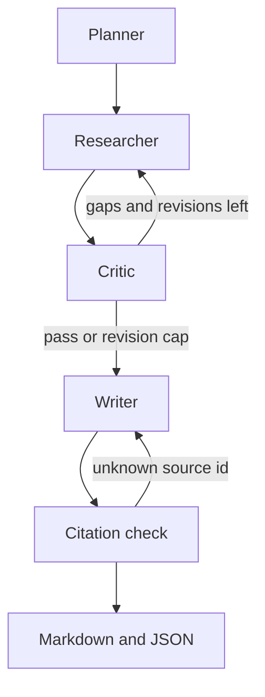

# Research team

**If the model cites a source it never fetched, the run fails.**

Four agents plan a topic, fetch public pages, and write a technical report. Every citation has to point at a page from that run. Groq, Gemini, Together.ai, or a local Ollama model. No paid key required for the demo.

```text
uv run research --demo
```

That command uses no API key and no network. It runs the same graph. The first draft invents `[S99]`. The check sends it back. The file that lands on disk cites only the page that was retrieved:

```text
Planning the report.
Searching: Bloom filter membership test
Reviewing coverage.
Searching: Bloom filter false negatives
Reviewing coverage.
Writing the report.
Rejected 1 unknown citation.
Writing the report.
Citations match retrieved sources.
examples/bloom-filter.md
```

```markdown
# How a Bloom filter rejects a missing key

> 1 source cited · 3 claims · 0 unknown citations

A Bloom filter tests set membership. It can say a key is definitely absent.
False positives are possible, but false negatives are not. [S1]

## False results

- False positive matches are possible, but false negatives are not. [S1]
- Burton Howard Bloom conceived the structure in 1970. [S1]

## Bibliography

- [S1] Bloom filter. https://en.wikipedia.org/wiki/Bloom_filter
```

The full file is [examples/bloom-filter.md](examples/bloom-filter.md). [examples/bloom-filter.json](examples/bloom-filter.json) is the audit trail: plan, excerpts, claims, and the critic's verdict.

The demo's excerpt is bundled so the command can run anywhere. The Wikipedia URL is real. A normal run searches DuckDuckGo and arXiv, fetches the pages, and calls the model you configure.

The check fails unknown ids such as `[S99]`. It does not prove a sentence is true. A model can still pin a real source id on a claim the page does not support. The critic sees the excerpts. The gate sees the ids.

## Run it on your topic

```text
uv sync --extra dev
copy .env.example .env
uv run research "How retrieval-augmented generation cites sources"
```

On macOS or Linux, use `cp .env.example .env`. Stdout prints the Markdown path. Progress and errors go to stderr. The same folder gets a `.json` file. `reports/` and `.env` are gitignored.

```text
uv run research "How retrieval-augmented generation cites sources" --provider gemini --out reports/rag.md
uv run research "How retrieval-augmented generation cites sources" --provider ollama --max-revisions 0
```

```python
from research_team import run_research

result = run_research("How a Bloom filter rejects a missing key", provider="groq")
print(result.markdown_path)
```

Python 3.11 or newer. Without uv: `python -m venv .venv`, activate it, then `pip install -e ".[dev]"`.

## Pipeline



The researcher searches a fixed list of queries and makes one extraction call per query. It does not run an open tool loop. The critic gets one revision by default. The writer gets one retry after a failed citation check. arXiv requests are spaced three seconds apart, and pages are cached for the run.

## Providers

| Provider | Environment | Default model | Notes |
| --- | --- | --- | --- |
| `groq` | `GROQ_API_KEY` | `openai/gpt-oss-120b` | Default. Free tier is about 30 requests per minute and 200,000 tokens per day. Llama 3.1 and 3.3 chat ids are enterprise-only on Groq. |
| `together` | `TOGETHER_API_KEY` | `openai/gpt-oss-120b` | Signup credits, not an ongoing free tier. |
| `gemini` | `GEMINI_API_KEY` | `gemini-3.8-flash` | Better choice for a long report. Create the key in [Google AI Studio](https://aistudio.google.com/apikey). |
| `ollama` | none | `qwen2.5:7b` | Local. `ollama pull qwen2.5:7b`, then `--provider ollama`. |

`LLM_PROVIDER` is the fallback when you omit `--provider`. `PLANNER_MODEL`, `RESEARCHER_MODEL`, `CRITIC_MODEL`, and `WRITER_MODEL` override one role. `MAX_REVISIONS` defaults to `1`.

Keys: [Groq](https://console.groq.com/keys), [Together](https://api.together.ai/settings/api-keys), [Gemini](https://aistudio.google.com/apikey).

## Development

```text
uv sync --extra dev
uv run ruff check .
uv run ruff format .
uv run pytest
uv run pytest -m live
```

The default suite mocks the network. `pytest -m live` sends one planner call to `LLM_PROVIDER`. CI runs Ruff and the default suite on Python 3.12 and 3.14.

## License

[MIT](LICENSE)
